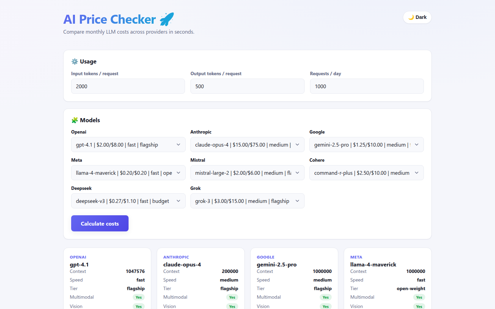

# AI Price Checker

A full-stack web app for estimating and comparing monthly LLM API costs across providers (OpenAI, Anthropic, Google, and more). Enter your expected token usage and request volume to see a side-by-side cost breakdown with charts and tables.



## Live URLs

| Service  | URL                                             |
| -------- | ----------------------------------------------- |
| Frontend | https://ai-price-checker.vercel.app             |
| Backend  | https://ai-price-checker-mnv9.onrender.com      |

> The backend runs on Render's free tier and sleeps after ~15 minutes of inactivity, so the first request after idle may take ~50 seconds to wake it up.

## Tech Stack

- **Backend:** Python, [FastAPI](https://fastapi.tiangolo.com/), Pydantic, Uvicorn
- **Frontend:** React (Create React App), Axios, Chart.js
- **Deployment:** Render (backend, Docker) + Vercel (frontend)

## Project Structure

```
.
├── backend/          # FastAPI app
│   ├── app/          # routes, models, calculator, pricing data
│   ├── Dockerfile
│   └── requirements.txt
├── frontend/         # React (CRA) app
│   ├── src/          # components, API client
│   ├── Dockerfile    # nginx-served static build
│   └── package.json
├── docker-compose.yml
└── render.yaml       # Render deployment blueprint
```

## API Endpoints

| Method | Path          | Description                                              |
| ------ | ------------- | ------------------------------------------------------- |
| GET    | `/`           | Health / readiness check (status + pricing metadata)    |
| GET    | `/health`     | Alias of `/`                                            |
| GET    | `/providers`  | Pricing metadata (`version`, `last_updated`, `source`) + the full dataset |
| GET    | `/models`     | List models, filterable by `provider`, `tier`, `speed`, `multimodal` |
| POST   | `/calculate`  | Compute monthly costs for selected models               |

**`POST /calculate` request body:**

```json
{
  "input_tokens": 1000,
  "output_tokens": 1000,
  "requests_per_day": 100,
  "selected_models": { "openai": "gpt-4o", "anthropic": "claude-sonnet-5-5" }
}
```

Returns `{ results: [...], warnings: [...] }`. `results` is sorted ascending by
`monthly_cost`; `warnings` lists any selected provider/model that wasn't found
in the pricing data (so a stale client gets explicit feedback instead of a
silently-empty result). Token fields must be positive integers.

**Error responses** use a single, consistent envelope:

```json
{ "error": { "code": "validation_error", "message": "Request validation failed.", "details": [ ... ] } }
```

## Local Development

### Backend

```bash
cd backend
pip install -r requirements.txt
uvicorn app.main:app --reload
```

The API runs at `http://127.0.0.1:8000`.

### Frontend

```bash
cd frontend
npm install
npm start
```

The app runs at `http://localhost:3000` and talks to the backend at `http://127.0.0.1:8000` by default.

### Docker Compose

```bash
docker-compose up --build
```

## Configuration

All backend configuration is read from environment variables in one place
(`backend/app/config.py`); see `backend/.env.example` for a template.

| Variable              | Service  | Default | Description                                                        |
| --------------------- | -------- | ------- | ----------------------------------------------------------------- |
| `ENVIRONMENT`         | Backend  | `development` | `development` \| `staging` \| `production`. In `production` the app **refuses to boot** with a wildcard or missing `CORS_ORIGINS`. |
| `CORS_ORIGINS`        | Backend  | `http://localhost:3000` | Comma-separated allowed browser origins. |
| `LOG_LEVEL`           | Backend  | `INFO`  | Standard logging level (`DEBUG`/`INFO`/`WARNING`/`ERROR`).         |
| `PRICING_FILE`        | Backend  | bundled | Optional override path to the pricing JSON file.                   |
| `REACT_APP_API_URL`   | Frontend | `http://127.0.0.1:8000` | Backend base URL, baked in at build time (CRA requires a rebuild). |

## Local Validation

Run the same checks CI runs, with minimal friction:

```bash
# Backend (from backend/)
pip install -r requirements-dev.txt
ruff check .                                  # lint
python -m scripts.validate_pricing            # validate pricing data
python -m pytest                              # unit + API tests

# Frontend (from frontend/)
CI=true npm test                              # test suite
CI=true npm run build                         # production build check
```

## Operations & Observability

- **Logging:** every request is logged to stdout with method, path, status, and
  duration; validation failures, skipped unknown models, and unhandled errors
  are logged too. Control verbosity with `LOG_LEVEL`.
- **Health / readiness:** `GET /` (also the platform health check path) returns
  `status`, `environment`, and pricing metadata (model/provider counts,
  `last_updated`). A malformed pricing dataset makes the app fail at startup
  rather than serve bad data.
- **Pricing lifecycle:** the dataset is static JSON, hardened with startup
  validation, a CI validation gate, a monthly staleness check, and provenance
  metadata. See [docs/PRICING.md](docs/PRICING.md) for the refresh workflow.
- **Deployment risks:** the Render free tier sleeps after ~15 min idle (first
  request can take ~50s — the frontend uses a 60s timeout to tolerate this);
  `REACT_APP_API_URL` is baked in at build time, so changing it requires a
  frontend redeploy.

## Deployment

- **Backend (Render):** Docker runtime, root dir `backend`. Set `ENVIRONMENT=production` and `CORS_ORIGINS` to the frontend origin. See `render.yaml`.
- **Frontend (Vercel):** CRA framework, root dir `frontend`. Set `REACT_APP_API_URL` to the backend URL. Auto-deploys on push to `master`.

CRA bakes environment variables at build time — changing `REACT_APP_API_URL` requires a redeploy.
