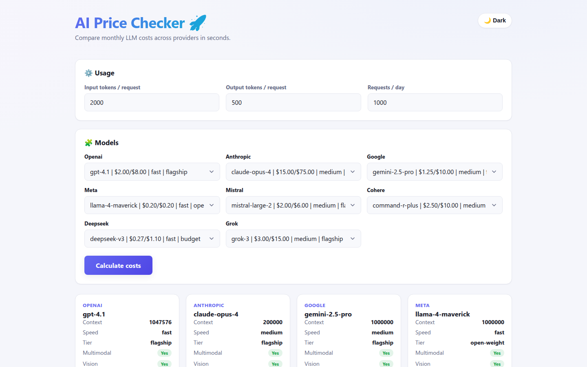

# AI Price Checker

A full-stack web app for estimating and comparing monthly LLM API costs across providers (OpenAI, Anthropic, Google, and more). Enter your expected token usage and request volume to see a side-by-side cost breakdown with charts and tables.



## Live URLs

| Service  | URL                                             |
| -------- | ----------------------------------------------- |
| Frontend | https://ai-price-checker.vercel.app             |
| Backend  | https://ai-price-checker-mnv9.onrender.com      |

> The backend runs on Render's free tier and sleeps after ~15 minutes of inactivity, so the first request after idle may take ~50 seconds to wake it up.

## Tech Stack

- **Backend:** Python, [FastAPI](https://fastapi.tiangolo.com/), Pydantic, Uvicorn
- **Frontend:** React (Create React App), Axios, Chart.js
- **Deployment:** Render (backend, Docker) + Vercel (frontend)

## Project Structure

```
.
├── backend/          # FastAPI app
│   ├── app/          # routes, models, calculator, pricing data
│   ├── Dockerfile
│   └── requirements.txt
├── frontend/         # React (CRA) app
│   ├── src/          # components, API client
│   ├── Dockerfile    # nginx-served static build
│   └── package.json
├── docker-compose.yml
└── render.yaml       # Render deployment blueprint
```

## API Endpoints

| Method | Path          | Description                                              |
| ------ | ------------- | ------------------------------------------------------- |
| GET    | `/`           | Health check                                            |
| GET    | `/providers`  | Returns the full pricing dataset                        |
| GET    | `/models`     | List models, filterable by `provider`, `tier`, `speed`, `multimodal` |
| POST   | `/calculate`  | Compute monthly costs for selected models               |

**`POST /calculate` request body:**

```json
{
  "input_tokens": 1000,
  "output_tokens": 1000,
  "requests_per_day": 100,
  "selected_models": { "openai": "gpt-4o", "anthropic": "claude-sonnet-4" }
}
```

Returns `{ results: [...] }` sorted ascending by `monthly_cost`.

## Local Development

### Backend

```bash
cd backend
pip install -r requirements.txt
uvicorn app.main:app --reload
```

The API runs at `http://127.0.0.1:8000`.

### Frontend

```bash
cd frontend
npm install
npm start
```

The app runs at `http://localhost:3000` and talks to the backend at `http://127.0.0.1:8000` by default.

### Docker Compose

```bash
docker-compose up --build
```

## Configuration

| Variable              | Service  | Description                                                        |
| --------------------- | -------- | ----------------------------------------------------------------- |
| `CORS_ORIGINS`        | Backend  | Comma-separated allowed origins (defaults to permissive `*`)       |
| `REACT_APP_API_URL`   | Frontend | Backend base URL, baked in at build time (CRA requires a rebuild)  |

## Deployment

- **Backend (Render):** Docker runtime, root dir `backend`. Set `CORS_ORIGINS` to the frontend origin. See `render.yaml`.
- **Frontend (Vercel):** CRA framework, root dir `frontend`. Set `REACT_APP_API_URL` to the backend URL. Auto-deploys on push to `master`.

CRA bakes environment variables at build time — changing `REACT_APP_API_URL` requires a redeploy.
